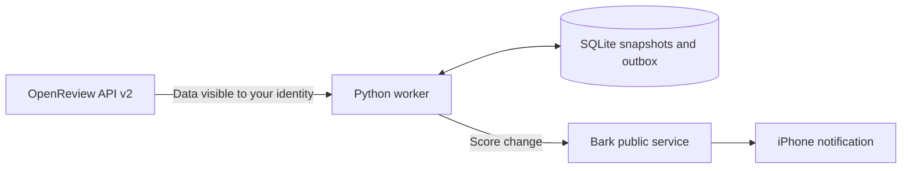

# ICLR Alert

**Let a worker check OpenReview and let your iPhone tell you the scores.**

[中文](README.md) · [Deployment guide](docs/DEPLOYMENT.md) · [Security](SECURITY.md) · [Contributing](CONTRIBUTING.md) · [MIT License](LICENSE)

ICLR Alert monitors the official reviews currently visible to your OpenReview identity. When scores first become readable, another scored review appears, or an existing rating or confidence changes, it sends a notification through the existing [Bark iPhone app](https://github.com/Finb/Bark). You do not need to build, sign, or publish an iOS client.

The worker uses the Python standard library, OpenReview API v2, and SQLite. Run it locally, in Docker, or on Railway. **A local worker needs an online computer; a cloud worker continues when your computer is off.**

## Features and scope

| Capability | Behavior |
| --- | --- |
| First visible scores | Notifies even when scores already exist on the first run |
| Review changes | Detects new scored reviews, rating changes, and confidence changes |
| Useful notifications | Includes visible ratings, confidence, a computed average, and a paper link |
| Durable deduplication | SQLite stores snapshots and pending events across restarts |
| Failure recovery | Backs off on network errors and retains unaccepted push events |
| Authentication failures | Attempts a status alert and pauses for normal login or manual verification |
| Deployment | One background worker; no public website, domain, or inbound port required |

The current parser expects API v2 invitations ending in `/-/Official_Review`, with `rating` and `confidence` fields. Venues with different schemas need an adapter. Running on OpenReview alone does not establish compatibility.

This is polling, with a **120-second** default interval. Polling, network requests, Bark, and Apple delivery all add latency. There is no instant-delivery or exactly-once guarantee. Averages are calculated by this program and are not official conference decisions.

## Architecture



Example notification, using **fictional demonstration scores**:

```text
ICLR：评审分数已可见
A demo paper
当前可见 3 份评审，可读评分 3 份。
Reviewer_A：6: Weak Accept；置信度 4
Reviewer_B：6: Weak Accept；置信度 3
Reviewer_C：5: Borderline；置信度 4
当前可读评分均值（本程序计算）：5.6667
```

The current interactive prompts and notifications are primarily Chinese. Notification times use Beijing time, UTC+8; worker logs use timezone-qualified UTC timestamps. The English README does not imply an English UI or configurable locale.

## Requirements

- Python **3.11+**. The core application has no third-party Python runtime dependencies.
- A paper URL such as `https://openreview.net/forum?id=YOUR_FORUM_ID`. Replace the placeholder with your own paper ID.
- Bark installed on an iPhone, with notifications allowed.
- Your own OpenReview account when anonymous access is unavailable or reviews require an authenticated identity.

Windows supports interactive login and protected local session storage. macOS, Linux, and Docker use a session supplied through the environment; see their instructions below.

## Windows quick start

### 1. Install from source

In PowerShell:

```powershell
git clone https://github.com/cristianhtvc/iclr-alert.git
cd iclr-alert
python -m venv .venv
.\.venv\Scripts\python.exe -m pip install -e .
```

The examples invoke the virtual environment directly, without requiring PowerShell activation or an execution-policy change.

### 2. Select a paper

```powershell
.\.venv\Scripts\python.exe -m iclr_alert paper "https://openreview.net/forum?id=YOUR_FORUM_ID"
```

A bare forum ID also works. The project ships without a personal paper as its default target.

### 3. Configure and test Bark

In the Bark app, find the push URL:

```text
https://api.day.app/YOUR_DEVICE_KEY/...
```

The URL contains the **Device Key**, which is different from the **Device Token** in the settings screen. Prefer the original Key stored by the app so it can synchronize future device-token changes.

```powershell
.\.venv\Scripts\python.exe -m iclr_alert bark-key
.\.venv\Scripts\python.exe -m iclr_alert bark-test
```

`bark-key` reads the Key without echoing it. `bark-test` sends one explicitly labeled test notification. After the provider accepts it, verify the test ID on your phone to establish actual receipt.

This release targets the Bark public service, `https://api.day.app`. It does not expose a setting for a self-hosted Bark endpoint. See the [official Bark API tutorial](https://github.com/Finb/Bark/blob/master/docs/en-us/tutorial.md).

### 4. Sign in normally

```powershell
.\.venv\Scripts\python.exe -m iclr_alert login-gui
```

Enter your account, password, and any required email OTP or TOTP in the local window. If Tkinter is unavailable, use hidden terminal input:

```powershell
.\.venv\Scripts\python.exe -m iclr_alert login
```

Passwords and one-time codes are used only for that official login and are not persisted. The session token is protected with Windows DPAPI for the current user. Sessions are not permanent, and the server controls their actual validity. This tool does not extract browser cookies or automate access-verification challenges or CAPTCHAs. Authentication follows the [official OpenReview login protocol](https://github.com/openreview/openreview-py/blob/master/openreview/api/client.py).

### 5. Verify and monitor

```powershell
# Read-only: does not send score notifications
.\.venv\Scripts\python.exe -m iclr_alert probe

# Check once: may send a real score notification
.\.venv\Scripts\python.exe -m iclr_alert check

# Continue polling; Ctrl+C stops the process
.\.venv\Scripts\python.exe -m iclr_alert watch
```

The optional `login.ps1` and `monitor.ps1` wrappers prefer the project's `.venv` and otherwise use system Python.

## macOS, Linux, and environment-based usage

```bash
git clone https://github.com/cristianhtvc/iclr-alert.git
cd iclr-alert
python3 -m venv .venv
source .venv/bin/activate
python -m pip install -e .
python -m iclr_alert paper 'https://openreview.net/forum?id=YOUR_FORUM_ID'
python -m iclr_alert bark-key
```

The CLI `login` and `login-gui` storage flow is Windows-only in this release. Elsewhere, provide a valid session as `OPENREVIEW_TOKEN`, or follow the [cross-platform session recipe](docs/DEPLOYMENT.md#session-setup) to authenticate in memory and start the worker. No browser-credential extraction is needed.

Set environment variables before starting the application. **The program does not automatically read `.env` files.** Docker's `--env-file` and Compose's `env_file` explicitly load them when requested.

## Commands

After installation, `iclr-alert` is equivalent to `python -m iclr_alert`.

| Command | Purpose | May send a notification? |
| --- | --- | --- |
| `paper <URL or ID>` | Set the target paper | No |
| `bark-key` | Enter the app's original Device Key without echo | No |
| `bark-test` | Send one test push | Yes, a test |
| `login` / `login-gui` | Windows login and read-only paper verification | No |
| `probe [--paper URL]` | Read using the configured session | No |
| `probe --anonymous` | Explicitly query without authentication | No |
| `check` | Check once and process score events | Yes |
| `watch` | Run continuous polling | Yes |
| `status` | Show configuration flags and the last outcome without credentials | No |
| `cloud-config` | Export private deployment variables locally; does not upload | No |

`serve` is an optional loopback-only diagnostic UI. It is not required for normal use and should not be exposed publicly.

## Configuration

| Variable | Default | Purpose |
| --- | --- | --- |
| `OPENREVIEW_PAPER` | Unset | Paper URL or ID; overrides the saved target |
| `OPENREVIEW_TOKEN` | Unset | Normally issued session; overrides local session storage |
| `BARK_DEVICE_KEY` | Unset | Key in the Bark push URL; overrides local configuration |
| `CHECK_INTERVAL_SECONDS` | `120` | Integer from 60 through 86400 seconds |
| `ICLR_CONFIG_DIR` | Project `.local` | Private configuration and Windows session directory; set before startup |
| `DATA_DIR` | Configuration directory | Durable SQLite/status directory; use `/data` in a container |

Default private state:

```text
.local/
  config.json                 # Paper and Bark configuration
  openreview-session.json     # Windows DPAPI-protected session
  monitor.sqlite3             # Snapshots and pending events
  monitor-status.json         # Last check result
  railway-variables.json      # Explicit cloud-config export; contains credentials
```

Do not commit these files. If you override the configuration or data directory, protect that location too; repository ignore rules do not secure arbitrary external paths.

## Docker and Railway

### Docker / Compose

```bash
cp cloud.env.example .env
# Edit .env locally with your paper, valid session and Bark Key
docker compose up -d --build
docker compose logs -f
```

Compose explicitly loads `.env` and stores state in a named volume. Stop it with `docker compose stop`. Keep the volume unless you intend to discard snapshots and deduplication state. This worker does not need public ports.

### Railway

1. Fork this repository and create a Railway service from your GitHub repository using its `Dockerfile`.
2. Set `OPENREVIEW_PAPER`, `OPENREVIEW_TOKEN`, `BARK_DEVICE_KEY`, `CHECK_INTERVAL_SECONDS=120`, and `DATA_DIR=/data` as private platform variables.
3. Attach a volume at `/data`, use one instance, disable sleeping, and do not configure a nonexistent HTTP health endpoint.
4. Read runtime logs after deployment. A successful deployment alone does not prove API access; verify `status=ok` and the `reviews` / `scored` counts.

On Windows, `python -m iclr_alert cloud-config` prepares `.local/railway-variables.json`. It contains plaintext deployment credentials, so do not commit or share it. The command does not upload, subscribe to a plan, or deploy.

Cloud trial availability, prices, and limits depend on your account and provider. The project does not promise indefinite free hosting. See the [deployment guide](docs/DEPLOYMENT.md) for full setup, cross-platform sessions, source-bundle deployment, and maintenance.

## FAQ

### What should I do about `ChallengeRequiredError`?

Check the paper URL and your account permissions, then try normal authentication. Login can help in some cases, but it is not a guarantee for every account, network, or cloud IP. If access verification is still required, complete the official flow manually or ask OpenReview which API access method is supported. The worker pauses rather than retrying aggressively or bypassing verification. See [OpenReview's official API documentation](https://docs.openreview.net/getting-started/using-the-api/installing-and-instantiating-the-python-client).

### Does `no_visible_reviews` mean reviews have not been released?

It means the API query succeeded but your current identity cannot see any official reviews matching the parser. Permissions, venue schemas, and staged releases can affect visibility. It does not establish a conference-wide release state. `ratings_unavailable` means reviews exist but no numeric rating is readable. Missing ratings are not converted to zero.

### Why must I log in again when a session expires?

The tool requests a session of up to one week using the official API. The server decides its actual lifetime and may invalidate it earlier. Passwords and authenticator secrets are not stored for automatic renewal. On an authentication or human-verification error, `watch` attempts one status alert and exits normally. Refresh the session and restart the worker or cloud deployment.

### Can notifications repeat or fail to arrive?

Accepted events are persisted so restarts do not resend them. A timeout is ambiguous: the provider may already have accepted the request. Retries reuse the notification ID to reduce duplicates, without an exactly-once guarantee. Provider acceptance is also not a device receipt; phone permissions, connectivity, and the push system still matter.

### Can I monitor multiple papers?

This release is designed for one paper per process, with one process per `DATA_DIR`. Use separate configuration and data directories for independent workers. There is no multi-user account system.

## Privacy and responsible use

OpenReview credentials go only to its official HTTPS API for authentication. Bark Keys are sent in POST bodies, and normal logs do not echo passwords, tokens, or Keys. Notifications send the paper title, reviewer labels, ratings, and confidence through the Bark public service and push delivery chain. End-to-end message encryption is not implemented here. Full review prose is not sent, and submissions are not modified.

Monitor only data you are authorized to read. Do not attach `.local`, `.env`, session data, Keys, or databases to issues, screenshots, logs, or forks. See [SECURITY.md](SECURITY.md). This is an independent project, not affiliated with ICLR, OpenReview, Bark, or Railway.

## Development and tests

```bash
python -m pip install -e .
python -m unittest discover -s tests -v
```

Tests use offline responses and temporary directories. They do not sign in to real accounts or send real pushes. Coverage includes API parsing, login/MFA, deduplication, snapshots and outbox recovery, backoff, worker locks, private configuration, and source-bundle validation. Follow [CONTRIBUTING.md](CONTRIBUTING.md) for reproducible reports and changes.

## License

[MIT](LICENSE). Retain the license and copyright notice when redistributing the project.
