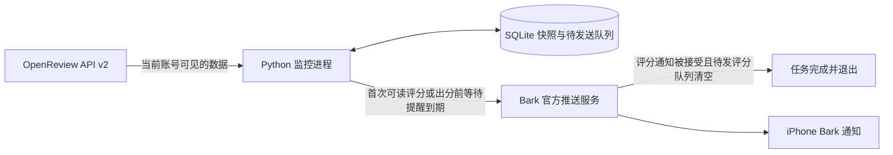

# ICLR Alert

**让云端检查 OpenReview，让 iPhone 告诉你分数。**

[English](README.en.md) · [部署指南](docs/DEPLOYMENT.md) · [安全说明](SECURITY.md) · [参与贡献](CONTRIBUTING.md) · [MIT License](LICENSE)

ICLR Alert 是一个个人出分提醒工具：定期读取指定论文当前身份可见的正式评审，首次发现至少一份可读数值评分时，通过现成的 [Bark](https://github.com/Finb/Bark) App 发送 iPhone 通知。尚未出分时，默认每小时发送一次鼓励提醒，可关闭或自定义文案。评分通知被 Bark 接受后，任务自动完成并停止。无需自己开发、签名或上架 iOS 客户端。

它使用 Python 标准库、OpenReview API v2 和 SQLite；可以在电脑上运行，也可以用 Docker 或 Railway 持续运行。**本机运行需要电脑在线；部署到云端后，电脑可以关机。**

## 功能与边界

| 能力 | 行为 |
| --- | --- |
| 评分首次可见 | 第一次运行时已经有评分，也会通知 |
| 自动完成 | 首次发现可读评分后停止等待提醒；评分通知获 Bark 接受后退出，不再监控后续改分 |
| 通知内容 | 当前可见各份评分、置信度、程序计算的均分及论文链接 |
| 等待提醒 | 仅在尚无可读数值评分时，默认每小时发送一次鼓励 |
| 持久化去重 | SQLite 保存快照和待发送事件，重启保留状态 |
| 失败恢复 | 网络错误退避；Bark 未接受的事件保留在队列中 |
| 身份失效 | 尝试发送状态提醒并暂停，等待重新登录或人工验证 |
| 部署 | 单进程后台 worker，无需公开网页、域名或入站端口 |

当前解析 API v2 中 invitation 以 `/-/Official_Review` 结尾的正式评审，读取 `rating` 和 `confidence`。其他会议若采用不同字段或表单，需要适配后才能使用，不能仅凭其运行在 OpenReview 上就认定兼容。

这是轮询工具，默认每 **120 秒**检查一次；等待提醒的默认间隔另为 **3600 秒**。到期提醒会在下一次成功检查时发送，因此还会受到轮询、网络、Bark 和 Apple 推送延迟的影响，不保证瞬时或严格一次送达。均分是本程序计算结果，不代表会议最终决定。

## 工作方式



示例通知如下，**分数为演示数据**：

```text
ICLR：评审分数已可见
！！！！！！！！！！重要警报！！！！！！你的ICLR分数出来了，快来看咋样
A demo paper
当前可见 3 份评审，可读评分 3 份。
Reviewer_A：6: Weak Accept；置信度 4
Reviewer_B：6: Weak Accept；置信度 3
Reviewer_C：5: Borderline；置信度 4
当前可读评分均值（本程序计算）：5.6667
```

评分提醒包含当前可见的评分、置信度及论文链接，并在正文第一行加入上面的警报文案。默认等待提醒如下：

```text
ICLR：继续等待
继续等待，不要着急，不要担心，你是最棒的！
```

当前通知和交互提示主要为中文；通知时间使用北京时间（UTC+8），程序日志使用带时区的 UTC 时间。

## 准备条件

- Python **3.11 或更新版本**；核心运行没有第三方 Python 依赖。
- 一个 OpenReview 论文链接，例如 `https://openreview.net/forum?id=YOUR_FORUM_ID`。将 `YOUR_FORUM_ID` 替换为自己的论文 ID。
- iPhone 安装 Bark，并允许通知。
- 若匿名请求不可用或评审需要身份权限，使用自己的 OpenReview 账号进行正常认证。

Windows 支持交互式登录和 DPAPI 加密会话保存；macOS、Linux 和 Docker 使用环境变量提供会话。详见下方对应步骤。

## Windows 快速开始

### 1. 下载并安装

在 PowerShell 中运行：

```powershell
git clone https://github.com/cristianhtvc/iclr-alert.git
cd iclr-alert
python -m venv .venv
.\.venv\Scripts\python.exe -m pip install -e .
```

以下命令使用虚拟环境的 Python，无需修改 PowerShell 执行策略或激活脚本。

### 2. 配置论文

```powershell
.\.venv\Scripts\python.exe -m iclr_alert paper "https://openreview.net/forum?id=YOUR_FORUM_ID"
```

也可以只传入论文 ID。程序会保存标准化链接，不内置任何人的论文作为默认监控目标。

### 3. 配置 Bark 并测试

打开 iPhone Bark 首页，找到类似下面的推送地址：

```text
https://api.day.app/YOUR_DEVICE_KEY/...
```

其中 `YOUR_DEVICE_KEY` 是推送所需的 **Device Key**。它与设置页中的 **Device Token** 不同。请使用 App 自己保存的推送地址中的 Key，便于 App 后续同步设备 Token 的变化。

```powershell
.\.venv\Scripts\python.exe -m iclr_alert bark-key
.\.venv\Scripts\python.exe -m iclr_alert bark-test
```

`bark-key` 隐藏输入并保存 Key；`bark-test` 会实际发送一条明确标注的测试通知。Bark 返回接受成功后，还应在手机上核对测试编号，才能确认设备收到。

当前版本使用 Bark 官方服务 `https://api.day.app`，暂未提供自托管 Bark 地址的配置选项。Bark API 的用法参见[官方教程](https://github.com/Finb/Bark/blob/master/docs/en-us/tutorial.md)。

### 4. 正常登录 OpenReview

```powershell
.\.venv\Scripts\python.exe -m iclr_alert login-gui
```

在本机窗口填写账号、密码及需要的邮箱验证码或 TOTP。没有图形环境或 Tkinter 不可用时，使用终端隐藏输入：

```powershell
.\.venv\Scripts\python.exe -m iclr_alert login
```

密码和一次性验证码只用于本次官方登录，不保存。会话 Token 使用当前 Windows 用户的 DPAPI 加密保存；它不是永久凭据，实际有效期由服务器控制。本工具不会读取浏览器 Cookie，也不会自动解决访问验证或 CAPTCHA。正常认证遵循 [OpenReview 官方登录协议](https://github.com/openreview/openreview-py/blob/master/openreview/api/client.py)。

### 5. 验证并启动监控

```powershell
# 只读查询，不发评分通知
.\.venv\Scripts\python.exe -m iclr_alert probe

# 检查一次；首次发现评分时可能发送真实通知
.\.venv\Scripts\python.exe -m iclr_alert check

# 等待出分；评分通知获接受后自动停止，也可 Ctrl+C 停止
.\.venv\Scripts\python.exe -m iclr_alert watch
```

也可运行仓库中的 `login.ps1` 和 `monitor.ps1`。这些脚本优先使用项目 `.venv`，其次使用系统 Python。

## macOS、Linux 与环境变量运行

```bash
git clone https://github.com/cristianhtvc/iclr-alert.git
cd iclr-alert
python3 -m venv .venv
source .venv/bin/activate
python -m pip install -e .
python -m iclr_alert paper 'https://openreview.net/forum?id=YOUR_FORUM_ID'
python -m iclr_alert bark-key
```

本版本的 `login` / `login-gui` 本地会话保存流程仅支持 Windows。其他系统可以使用通过正常官方认证获得的 `OPENREVIEW_TOKEN`，或者按[跨平台会话配置示例](docs/DEPLOYMENT.md#session-setup)在内存中登录并运行监控，无需提取浏览器凭据。

环境变量必须在启动程序前设置。**程序不会自动读取 `.env` 文件**；`.env` 只会在你明确使用 Docker 的 `--env-file` 或 Compose `env_file` 时加载。

## 命令说明

安装后也可用 `iclr-alert` 代替 `python -m iclr_alert`。

| 命令 | 用途 | 是否可能推送 |
| --- | --- | --- |
| `paper <URL或ID>` | 配置监控目标 | 否 |
| `bark-key` | 隐藏输入 App 原有 Device Key | 否 |
| `bark-test` | 发送一条测试通知 | 是，测试通知 |
| `login` / `login-gui` | Windows 正常登录并验证论文 API | 否 |
| `probe [--paper URL]` | 只读查询，使用已配置会话 | 否 |
| `probe --anonymous` | 显式以匿名身份查询 | 否 |
| `check` | 检查一次并处理评分通知及到期的等待提醒 | 是 |
| `watch` | 等待出分，评分通知获接受后自动完成退出 | 是 |
| `status` | 查看配置标记及上次监控结果，不回显凭据 | 否 |
| `cloud-config` | 在本机导出私有部署变量 JSON，不上传 | 否 |

`serve` 是可选的本机诊断界面，仅绑定回环地址；日常使用不需要启动它，也不要把它暴露到公网。

## 配置

| 变量 | 默认值 | 说明 |
| --- | --- | --- |
| `OPENREVIEW_PAPER` | 无 | 论文链接或 ID；优先于 `paper` 保存的配置 |
| `OPENREVIEW_TOKEN` | 无 | 正常认证获得的会话；优先于本机加密会话 |
| `BARK_DEVICE_KEY` | 无 | Bark App 推送地址中的 Key；优先于本机配置 |
| `CHECK_INTERVAL_SECONDS` | `120` | 60–86400 秒之间的整数 |
| `WAITING_REMINDER_SECONDS` | `3600` | 等待提醒间隔；`0` 关闭，其余为 60–86400 秒之间的整数 |
| `WAITING_MESSAGE` | `继续等待，不要着急，不要担心，你是最棒的！` | 等待提醒正文，非空纯文本，最多 2000 字符 |
| `SCORE_UPDATE_MESSAGE` | 下方默认警报文案 | 评分通知正文的第一行，非空纯文本，最多 2000 字符 |
| `ICLR_CONFIG_DIR` | 项目 `.local` | 私有配置和 Windows 会话目录；在启动前设置 |
| `DATA_DIR` | 配置目录 | SQLite 与监控状态目录；云端建议 `/data` |

默认私有文件包括：

```text
.local/
  config.json                 # 论文、Bark 与可选提醒配置
  openreview-session.json     # Windows DPAPI 加密会话
  monitor.sqlite3             # 快照、待发送事件与等待提醒时钟
  monitor-status.json         # 上次检查结果
  railway-variables.json      # 仅运行 cloud-config 后生成，含部署凭据
```

不要提交这些文件。自定义 `ICLR_CONFIG_DIR` 或 `DATA_DIR` 后，也需要自行保护新目录，不能仅依赖仓库的 `.gitignore`。

### 等待与评分提醒配置

等待提醒从首次成功但尚无可读数值评分的检查开始计时；计时状态持久化，重启不会清零。达到间隔后，在下一次成功检查时尝试发送。首次发现至少一份可读评分后，立即清除该论文的等待提醒，包括尚未发送成功的旧提醒；评分通知被 Bark 接受且待发评分队列清空后，`watch` 以退出码 `0` 自动结束，状态为 `action=completed`。完成后不再监控新增评审或后续改分。

Bark 未接受的评分通知保留原事件 ID 重试，成功后才完成任务；已有评分保存在 SQLite 中，因此此时重试不再依赖 OpenReview 会话。完成后重启也不会重新请求 OpenReview 或推送。升级时保留原状态目录，旧版已记录并推送成功的评分会直接被识别为任务完成。

API 请求失败时不会发送表示正常等待的鼓励通知。出分前的等待提醒发送失败会在后续成功检查时重试，不按错过的小时数积累补发。普通 Bark 推送失败不会触发指数退避；服务端要求的 `Retry-After` 等待时间仍会遵守。

默认文案与间隔为：

```dotenv
WAITING_REMINDER_SECONDS=3600
WAITING_MESSAGE=继续等待，不要着急，不要担心，你是最棒的！
SCORE_UPDATE_MESSAGE=！！！！！！！！！！重要警报！！！！！！你的ICLR分数出来了，快来看咋样
```

PowerShell 中可在启动前设置：

```powershell
$env:WAITING_REMINDER_SECONDS = '3600'
$env:WAITING_MESSAGE = '继续等待，不要着急，不要担心，你是最棒的！'
$env:SCORE_UPDATE_MESSAGE = '！！！！！！！！！！重要警报！！！！！！你的ICLR分数出来了，快来看咋样'
.\.venv\Scripts\python.exe -m iclr_alert watch
```

macOS / Linux shell 中对应为：

```bash
export WAITING_REMINDER_SECONDS=3600
export WAITING_MESSAGE='继续等待，不要着急，不要担心，你是最棒的！'
export SCORE_UPDATE_MESSAGE='！！！！！！！！！！重要警报！！！！！！你的ICLR分数出来了，快来看咋样'
```

这些消息参数按纯文本使用，不提供 `{title}`、`{rating}` 等模板插值；文案必须包含非空白内容，且最多 2000 字符。只想收到出分提醒时，将 `WAITING_REMINDER_SECONDS` 设为 `0`。Docker / Compose 用户可把相同配置写入 `.env`；已有容器需要重新创建后才能获得新的环境变量。

本机也可在现有 `.local/config.json` 中加入以下字段，保留已有论文与 Bark 配置。相应环境变量优先于本机字段；`cloud-config` 会导出解析后的设置。

```json
{
  "waiting_interval_seconds": 3600,
  "waiting_message": "继续等待，不要着急，不要担心，你是最棒的！",
  "update_message": "！！！！！！！！！！重要警报！！！！！！你的ICLR分数出来了，快来看咋样"
}
```

## Docker 与 Railway

### Docker / Compose

```bash
cp cloud.env.example .env
# 在本机编辑 .env，填写自己的论文、有效会话及 Bark Key
docker compose up -d --build
docker compose logs -f
```

Compose 会显式加载 `.env`，并将监控状态保存到命名卷。使用 `docker compose stop` 停止；不要删除状态卷，除非你接受丢失快照与去重状态。该项目是后台 worker，不需要公开端口。

### Railway

1. Fork 本仓库，用 Railway 从自己的 GitHub 仓库创建服务，使用项目内 `Dockerfile`。
2. 在平台私有变量中配置 `OPENREVIEW_PAPER`、`OPENREVIEW_TOKEN`、`BARK_DEVICE_KEY`、`CHECK_INTERVAL_SECONDS=120` 和 `DATA_DIR=/data`；等待提醒默认开启，可另设 `WAITING_REMINDER_SECONDS`、`WAITING_MESSAGE`、`SCORE_UPDATE_MESSAGE`。
3. 添加持久卷并挂载 `/data`；只运行一个实例，关闭自动休眠，不配置不存在的 HTTP 健康检查端点。
4. 启动后检查实际运行日志，确认出现 `status=ok` 及合理的 `reviews` / `scored` 计数。评分通知被接受并排空待发评分后，会记录 `action=completed` 并正常退出；保留仓库的 `ON_FAILURE` 重启策略，不要设为 `ALWAYS`。

更新部署时保留 `/data` 持久卷。若服务从 GitHub 构建，部署最新提交；若使用源码变量包，更新整组源码变量并重新部署，详见[源码包部署](docs/DEPLOYMENT.md#6-advanced-source-bundle-deployment)。

Windows 用户可以运行 `python -m iclr_alert cloud-config`，在 `.local/railway-variables.json` 中准备平台变量。该文件含明文部署凭据，不要提交或分享；命令不会自动上传、开通套餐或部署。

云服务的试用、费用和限额以平台当前账户为准，本项目不保证永久免费。详细步骤、跨平台会话准备、源码包部署选项与维护方法见[部署指南](docs/DEPLOYMENT.md)。

## 常见问题

### API 返回 `ChallengeRequiredError`，怎么办？

先确认论文链接和账号权限，再尝试本工具的正常登录流程。登录对某些访问情形有帮助，但不保证所有账号、网络或云端 IP 都能免于访问验证。若仍被要求验证，按官方页面人工处理，或向 OpenReview 确认支持的 API 访问方式；本工具会暂停，不会密集重试或绕过验证。参考 [OpenReview 官方 API 说明](https://docs.openreview.net/getting-started/using-the-api/installing-and-instantiating-the-python-client)。

### `no_visible_reviews` 是否说明会议还没出分？

它表示 API 查询成功，但**当前身份看不到符合解析规则的正式评审**。权限、会议表单、逐步开放等都可能影响可见结果；不能据此推断全会发布状态。`ratings_unavailable` 则表示可见评审存在，但没有可解析的数值评分。缺失值不会被当作 0 分。

### 为什么会话过期后要重新登录？

本工具按官方接口申请最长一周会话，服务器决定其实际有效期，也可提前使其失效。程序不保存密码或验证器密钥来自动续期。认证失效或需要人工验证时，`watch` 尝试发送一次状态提醒并正常退出；更新会话后需要重新启动监控或云端部署。

### 通知会重复或漏发吗？

已被服务接受的事件会持久化标记，重启保留该状态。若请求超时，服务可能已接受但客户端尚未收到响应；重试复用同一通知 ID 来减少重复，不能保证严格一次送达。Bark 服务接受也不等于 iPhone 已显示，手机权限、网络和推送服务仍会影响结果。

### 为什么没有更新评分也收到了通知？

尚无可读数值评分时，默认每 3600 秒发送一次“继续等待”鼓励提醒。它表示这一轮查询成功、等待提醒已到期，不代表出现新评分。首次发现评分后停止等待提醒，评分通知获 Bark 接受后任务自动完成。可以用 `WAITING_REMINDER_SECONDS=0` 关闭出分前的鼓励；查询周期仍由独立的 `CHECK_INTERVAL_SECONDS` 控制。API 错误不会被当作正常等待来发送鼓励。

### 能同时监控多篇论文吗？

当前面向一个进程监控一篇论文；同一 `DATA_DIR` 仅允许一个进程。若部署多个独立监控，请使用不同配置目录与状态目录。没有内置多用户账户系统。

## 隐私与使用说明

OpenReview 凭据只用于向其官方 HTTPS 接口认证。Bark Key 放在 POST 请求体中，正常日志不输出密码、Token 或 Key。评分通知会将论文标题、评审标识、评分和置信度发送给 Bark 官方服务及推送链路；当前实现没有端到端消息加密。它不发送完整评审正文，也不会修改你的投稿。

仅监控你获准读取的数据。不要在 Issue、截图、日志附件或 Fork 中分享 `.local`、`.env`、会话、Key 或数据库。更多内容见[安全说明](SECURITY.md)。本项目与 ICLR、OpenReview、Bark 和 Railway 均无官方隶属关系。

## 开发与测试

```bash
python -m pip install -e .
python -m unittest discover -s tests -v
```

测试使用离线响应和临时目录，不登录真实账号、不发送真实通知。覆盖 API 解析、正常登录及验证码、去重、快照与待发送队列、失败恢复、退避、单实例锁、私有配置和源码包验证。欢迎按[贡献指南](CONTRIBUTING.md)提交可复现的问题与改进。

## 许可证

[MIT](LICENSE)。引用和复用时请保留许可证与版权声明。
